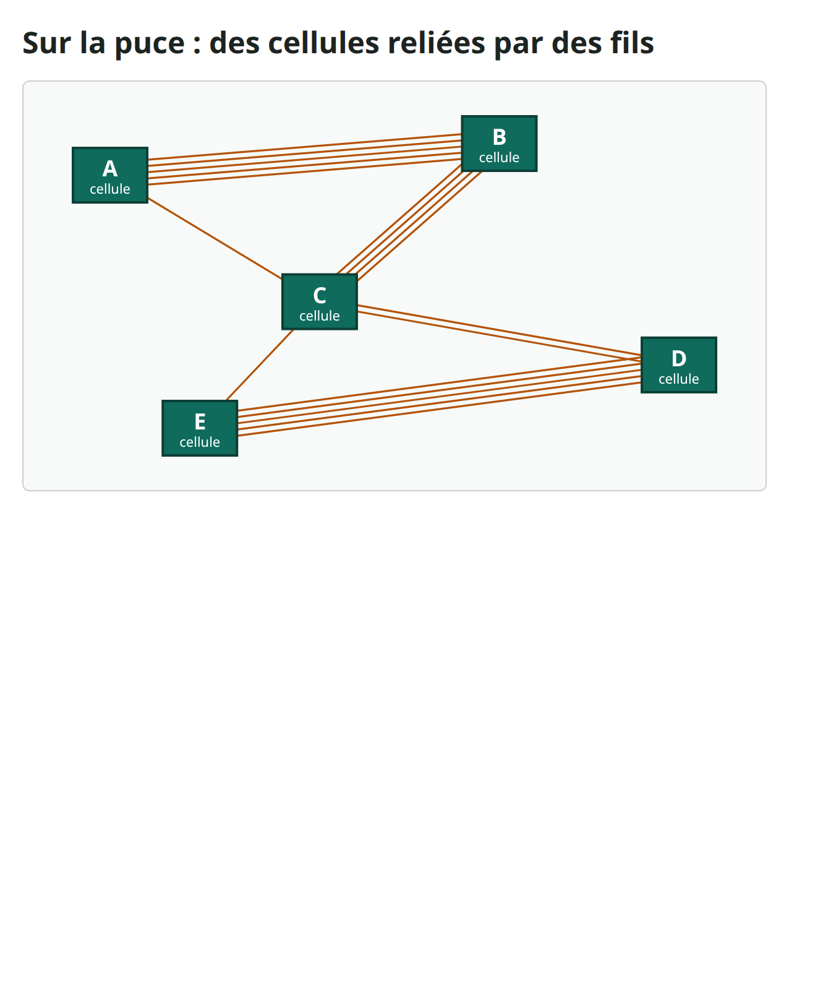
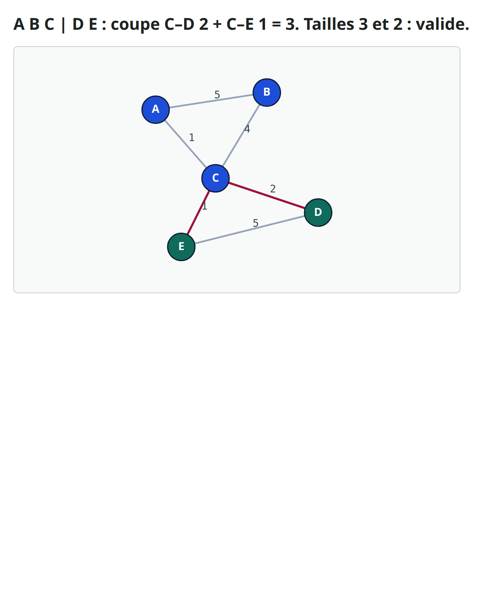
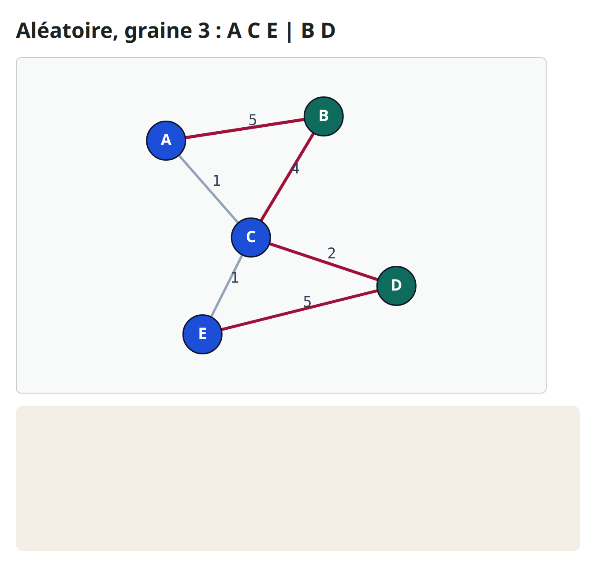
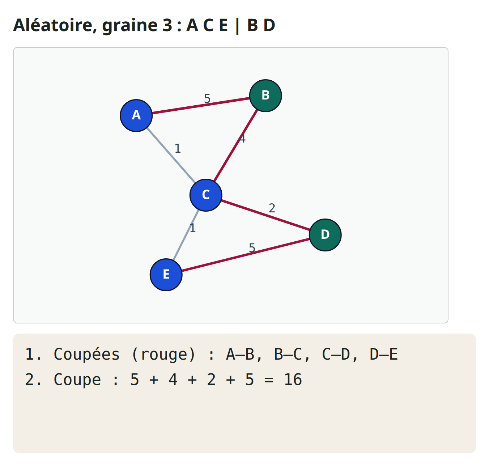
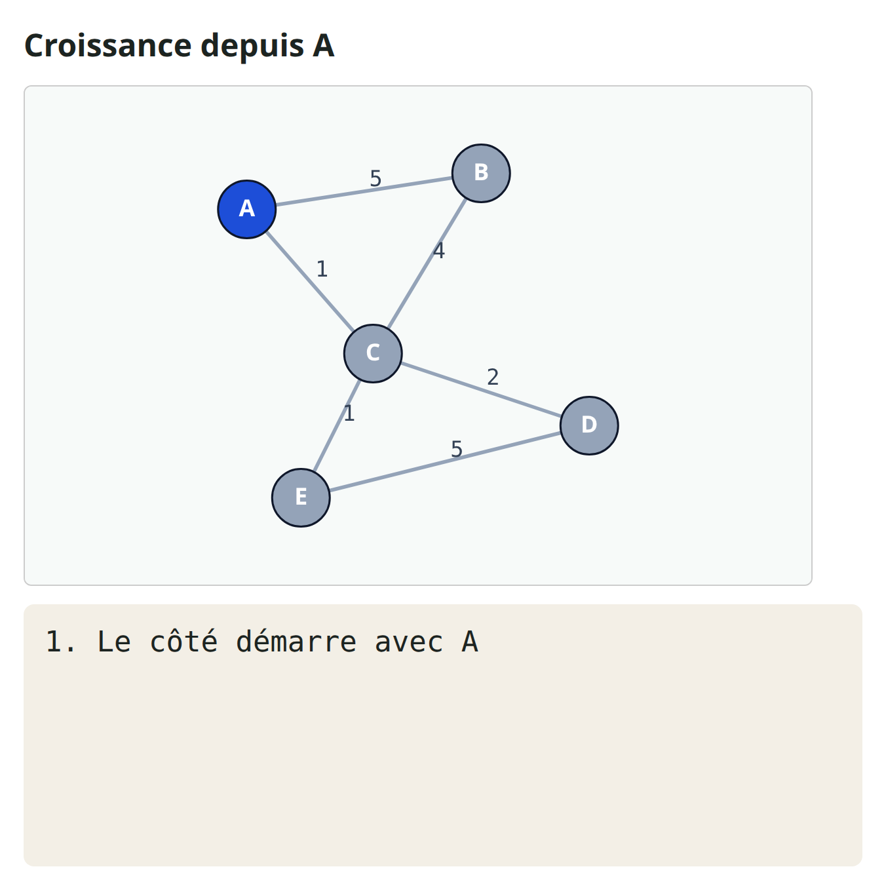
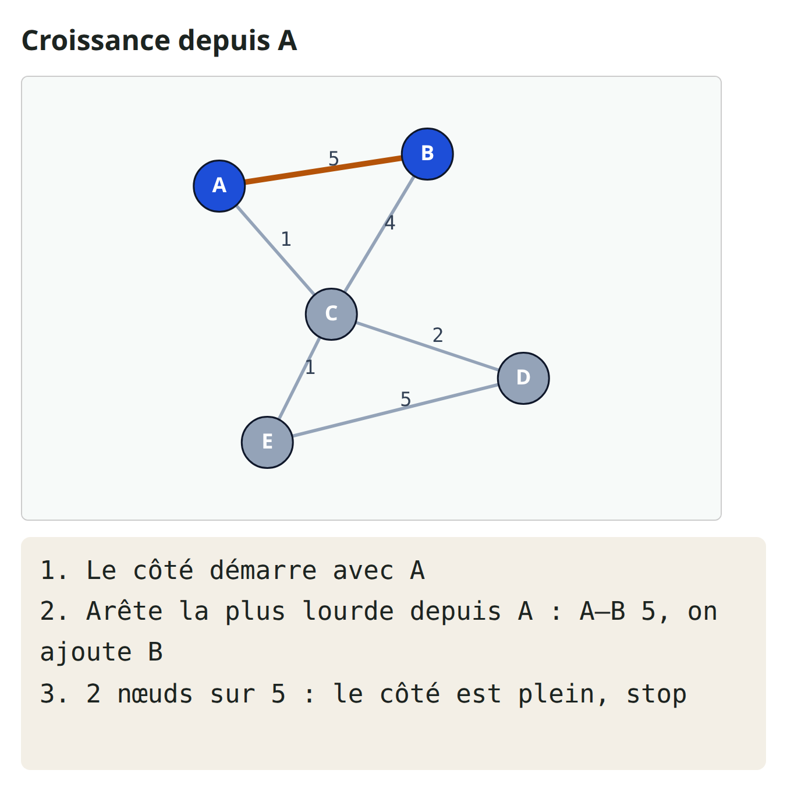
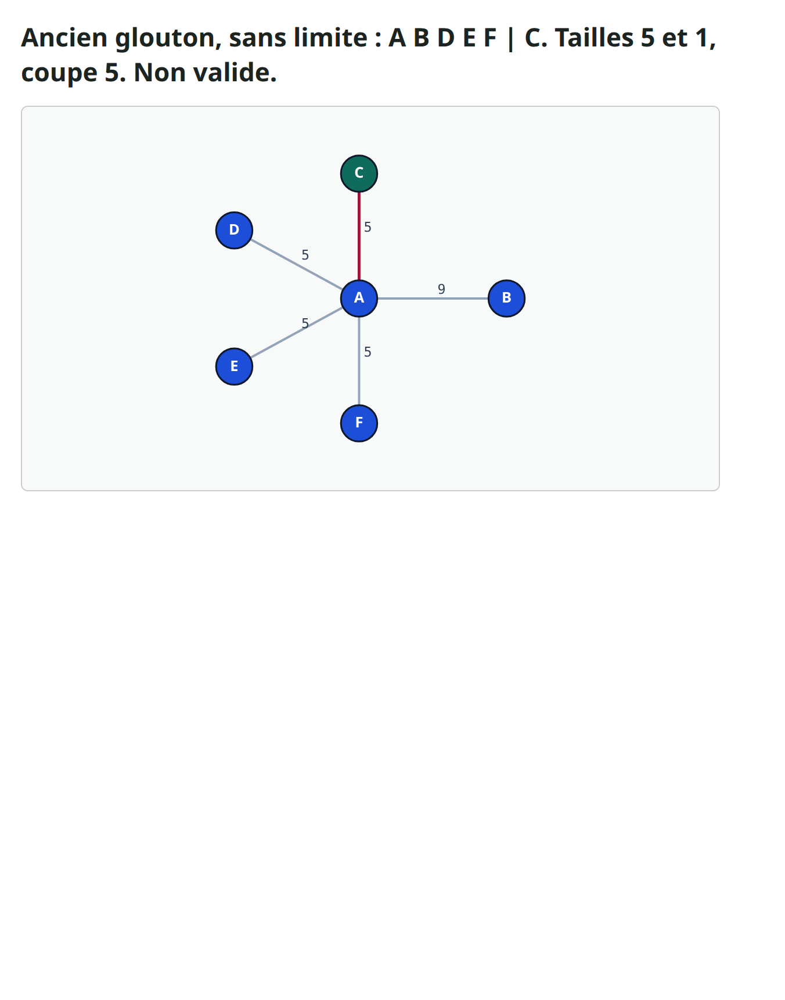
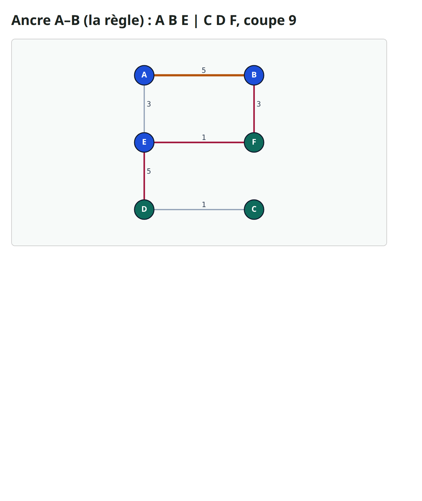
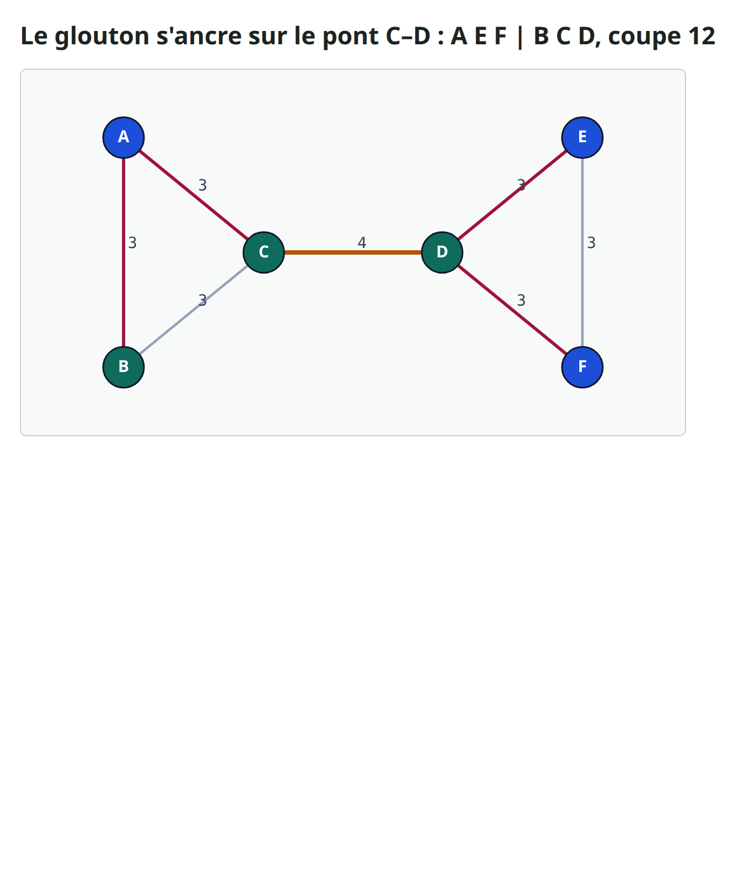

# Bipartition initiale

Avant d'améliorer une coupe, il faut une première coupe, appelée la bipartition initiale

---

## D'une puce à un graphe
- Une puce est faite de petites briques appelées cellules, reliées par des fils
- Notre exemple a cinq cellules, nommées de A à E
- Certaines paires partagent beaucoup de fils, d'autres un seul


---

## Les cellules deviennent des points, les fils des traits
- On dessine chaque cellule comme un point, appelé nœud
- Un trait entre deux nœuds est une arête
- Son nombre, le poids, compte les fils entre les deux cellules
- A–B et D–E sont les plus lourdes, avec cinq fils chacune


---

## Deux nombres : coupe et équilibre
- Couper les cellules en deux côtés s'appelle une bipartition
- Les arêtes qui passent d'un côté à l'autre sont coupées, et dessinées en rouge
- La taille de coupe additionne leurs poids : ici, deux plus un font trois


---

## L'équilibre : aucun côté trop gros
- Tout mettre du même côté donne une coupe de zéro, mais cela ne sert à rien
- On vérifie donc aussi l'équilibre : combien de cellules chaque côté contient
- Une partition est valide quand aucun côté ne dépasse trois cellules sur cinq


---

## Pourquoi une partition de départ ?
- Les labs quatre et cinq enseignent deux méthodes célèbres, appelées KL et FM
- Elles améliorent une partition en déplaçant des cellules d'un côté à l'autre
- Mais KL et FM ont besoin d'une partition valide pour démarrer
- Pensez à former deux équipes : d'abord deux équipes au hasard, puis des échanges
- Un bon premier découpage laisse moins d'échanges à faire
- Faites une pause et devinez : le hasard peut-il aussi trouver une coupe de trois ?

---

## Trois façons de construire une première partition


---

## Aléatoire, graine 5 : ABC|DE, coupe 3


---

## Glouton : ABC|DE, coupe 3


---

## Croissance depuis D : ABC|DE, coupe 3


---

## Les trois trouvent une coupe de 3. Coup de chance ?


---

## Exemple détaillé : une graine malchanceuse
- Un seul mélange malchanceux peut rendre la coupe plus de cinq fois pire
- Donc oui, c'était en partie de la chance
- Avec la graine trois, B et D tombent d'un côté, et A, C et E de l'autre


---

## Additionner la coupe
- Additionnons la coupe, arête par arête
- A–B cinq, B–C quatre, C–D deux, et D–E cinq
- Cela fait seize


---

## La pire partition valide
- Les deux arêtes lourdes sont coupées : c'est la pire partition valide qui existe
- Sur seize graines, la coupe va de trois à seize
- Seules trois de ces graines trouvent la meilleure coupe, trois


---

## La croissance dépend du nœud de départ
- La croissance n'a pas de hasard, mais elle a un choix : le nœud de départ
- Partons de A au lieu de D


---

## Croissance depuis A, étape par étape
- L'arête la plus lourde qui sort de A va vers B, avec un poids de cinq, donc B rejoint A
- Avec deux cellules, le côté est plein, et il s'arrête


---

## Croissance depuis A : AB|CDE, coupe 5
- C, D et E forment l'autre côté, donc A–C et B–C sont coupées
- Un plus quatre font cinq, ce qui est pire que trois
- Partir de C est encore pire : une coupe de neuf


---

## Garder le meilleur départ valide
- La solution est simple : essayer plusieurs départs, garder le meilleur
- Construisez quelques graines aléatoires, le glouton, et la croissance depuis chaque nœud
- Jetez toute partition qui enfreint la règle de taille, puis gardez la plus petite coupe
- Ici, le glouton et les cinq croissances donnent trois, cinq, cinq, neuf, trois et trois
- Le meilleur est donc trois : A, B et C contre D et E
- Faites une pause et devinez : une coupe plus petite peut-elle être le mauvais choix ?

---

## Garder le meilleur départ valide — try these

```
best_start(graph):
  starts = random(seed) pour quelques graines
         + greedy
         + grow(x) pour chaque nœud x
  jeter chaque départ qui n'est pas valide
  renvoyer le départ de plus petite taille de coupe
```

---

## Piège 1 : pas de limite de taille
- Trois pièges peuvent tromper une méthode qui a l'air raisonnable
- Et oui, une coupe plus petite peut être le mauvais choix
- Voici une étoile : A au milieu, relié à cinq autres cellules
- Un ancien glouton sans limite de taille ajoutait toujours des cellules près de A
- Il finissait avec cinq cellules contre une, et une coupe de cinq


---

## Piège 1 : la limite de taille règle le problème
- Avec six cellules, il en faut trois par côté, donc cette partition n'est pas valide
- Notre glouton arrête chaque côté à trois cellules, et obtient quinze
- Aucune partition valide de cette étoile ne fait mieux


---

## Piège 2 : une égalité peut décider du résultat
- Dans ce graphe, A–B et D–E pèsent cinq toutes les deux
- Le glouton doit en choisir une pour démarrer
- La règle prend le plus petit nom, A–B, et cela donne une coupe de neuf


---

## Piège 2 : l'autre ancre
- Démarrer de D–E donne une coupe de quatre
- Une simple règle de départage a donc plus que doublé la coupe
- La croissance depuis C trouve aussi quatre


---

## Piège 3 : le fil le plus lourd n'est pas toujours à l'intérieur
- Voici deux triangles, reliés par un seul pont, C–D, de poids quatre
- Chaque arête de triangle pèse trois
- Le glouton démarre de l'arête la plus lourde, qui est ici le pont lui-même
- C et D commencent donc du même côté, et la coupe finit à douze


---

## Piège 3 : la croissance garde les triangles
- La croissance depuis A garde son triangle ensemble, et ne coupe que le pont : quatre
- Faites une pause et devinez : la croissance est-elle toujours meilleure que le glouton ?


---

## Parcours lab dans le navigateur


---

## Parcours implémentation


---

## Parcours implémentation — try these

```
# afficher toutes les bonnes réponses
python3 examples/initial_bipartition_check.py --show

# vérifier vos propres fonctions
python3 examples/initial_bipartition_check.py --impl my_init.py
```

---

## À retenir
- L'aléatoire est rapide, mais il dépend de la chance
- Le glouton garde les arêtes lourdes dedans, mais égalités et ponts le trompent
- La croissance dépend de son nœud de départ
- Donnez l'équilibre avec chaque coupe, et ne laissez aucun côté dépasser sa limite
- Départagez par le nom, pas par l'ordre du fichier d'entrée
- Donc : essayer plusieurs départs, garder le meilleur départ valide

---

## À vous de jouer
- Choisissez un parcours : le lab dans le navigateur, Python, ou les deux
- Cochez chaque case de la liste de contrôle, puis faites le court quiz
- La suite, c'est Kernighan–Lin, qui part de votre partition et l'améliore
- Faites une pause et devinez : de combien peut-il réduire la coupe malchanceuse de seize ?
- Le lab quatre vous le montrera

