# Bipartition initiale

Avant d'améliorer une coupe, il faut une première coupe

---

## D'une puce à un graphe
- Une puce est faite de petites briques appelées cellules, reliées par des fils
- On dessine chaque cellule comme un point, appelé nœud
- Un trait entre deux nœuds est une arête : les deux cellules sont reliées
- Le nombre sur une arête est son poids : combien de fils relient la paire
- Notre exemple a cinq cellules, de A à E
- Les arêtes les plus lourdes, A–B et D–E, ont cinq fils chacune
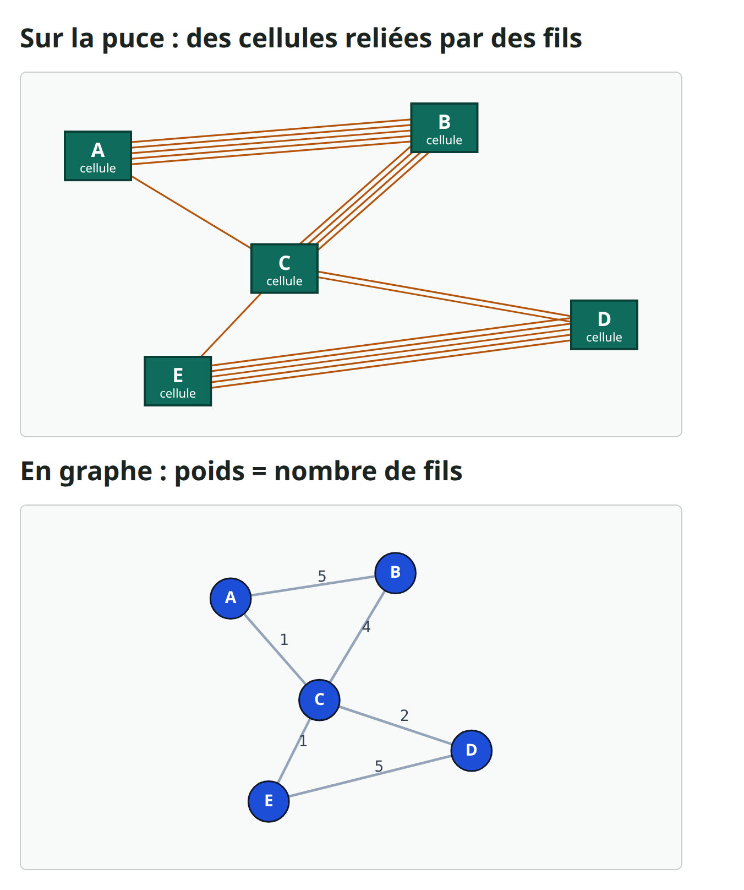

---

## Deux nombres : coupe et équilibre
- Couper une puce en deux côtés s'appelle une bipartition
- Les arêtes qui passent d'un côté à l'autre sont coupées, et on les dessine en rouge
- La taille de coupe additionne leurs poids : ici, deux plus un font trois
- Tout mettre du même côté donne une coupe de zéro, mais cela ne sert à rien
- On vérifie donc aussi l'équilibre : combien de cellules chaque côté contient
- Une partition est valide quand aucun côté ne dépasse trois cellules sur cinq
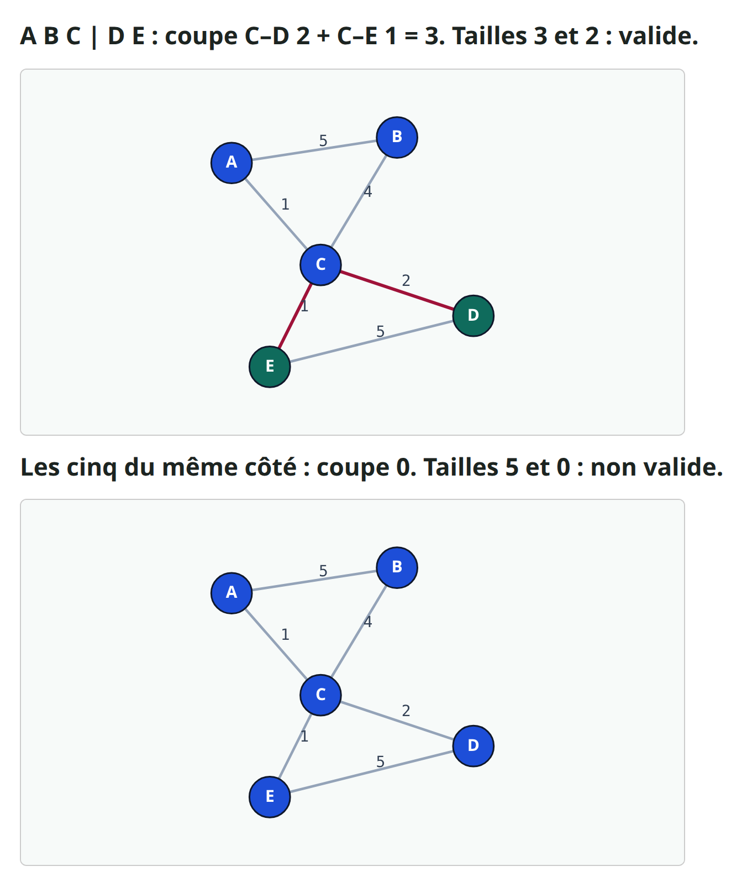

---

## Pourquoi une partition de départ ?
- Les labs quatre et cinq enseignent deux méthodes célèbres, appelées KL et FM
- Elles améliorent une partition en déplaçant des cellules d'un côté à l'autre
- Mais elles ne peuvent qu'améliorer : il leur faut une partition valide pour démarrer
- Pensez à former deux équipes pour un jeu
- D'abord deux équipes au hasard, puis on échange des joueurs pour équilibrer
- Un bon premier découpage laisse moins d'échanges à faire

---

## Il faut une partition de départ valide
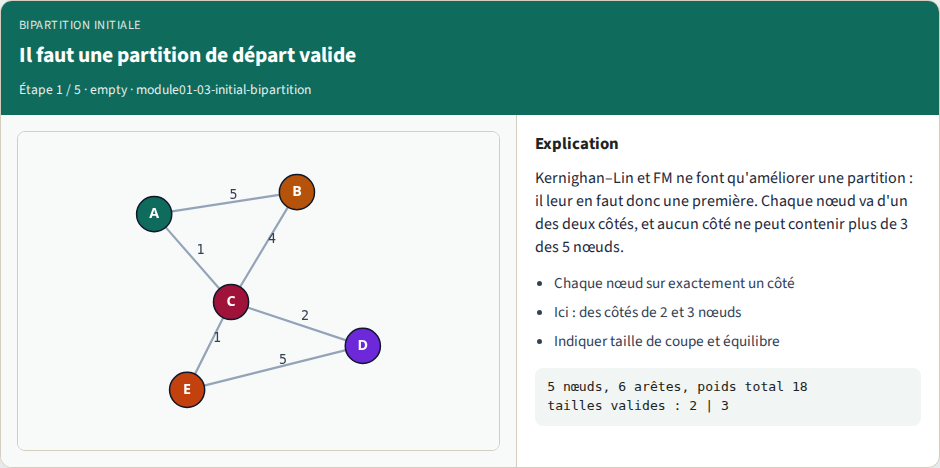

---

## Aléatoire, graine 5 : ABC|DE, coupe 3
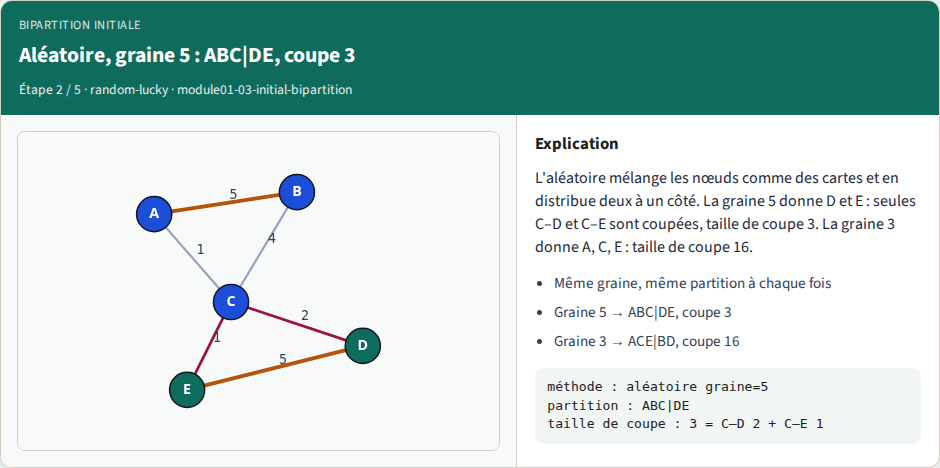

---

## Glouton : ABC|DE, coupe 3
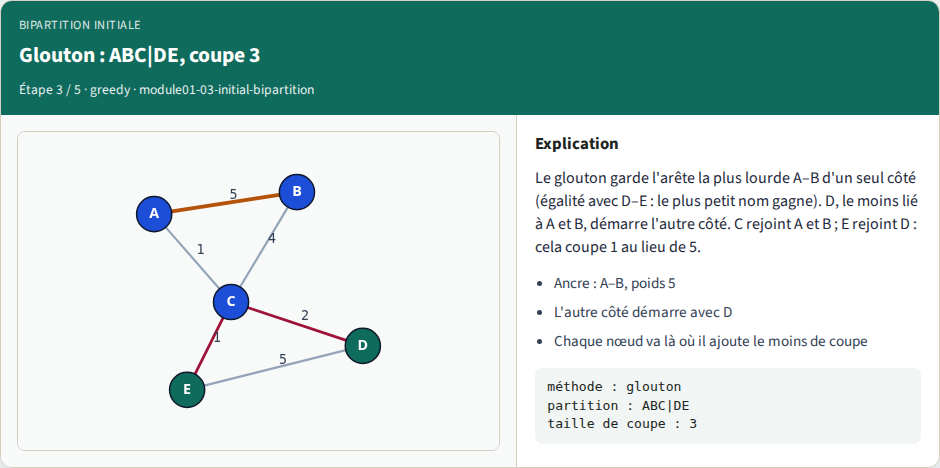

---

## Croissance depuis D : ABC|DE, coupe 3
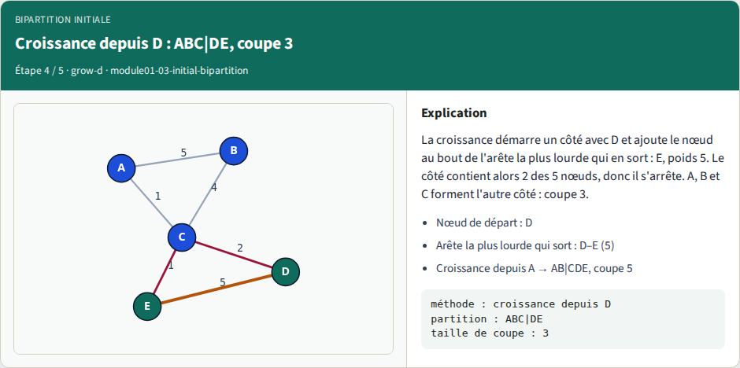

---

## Essayer plusieurs départs, garder le meilleur
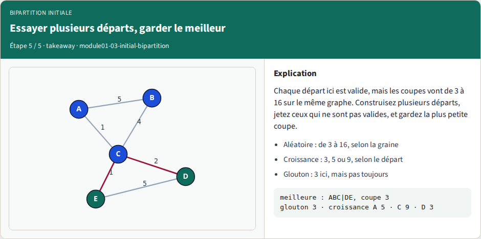

---

## Exemple détaillé : une graine malchanceuse
- Voyons maintenant jusqu'où peut aller la malchance
- Avec la graine trois, le mélange donne B et D à un côté
- A, C et E se retrouvent de l'autre
- Additionnons la coupe, arête par arête
- A–B cinq, B–C quatre, C–D deux et D–E cinq : seize au total
- Les deux arêtes lourdes sont coupées, donc c'est la pire partition valide qui existe
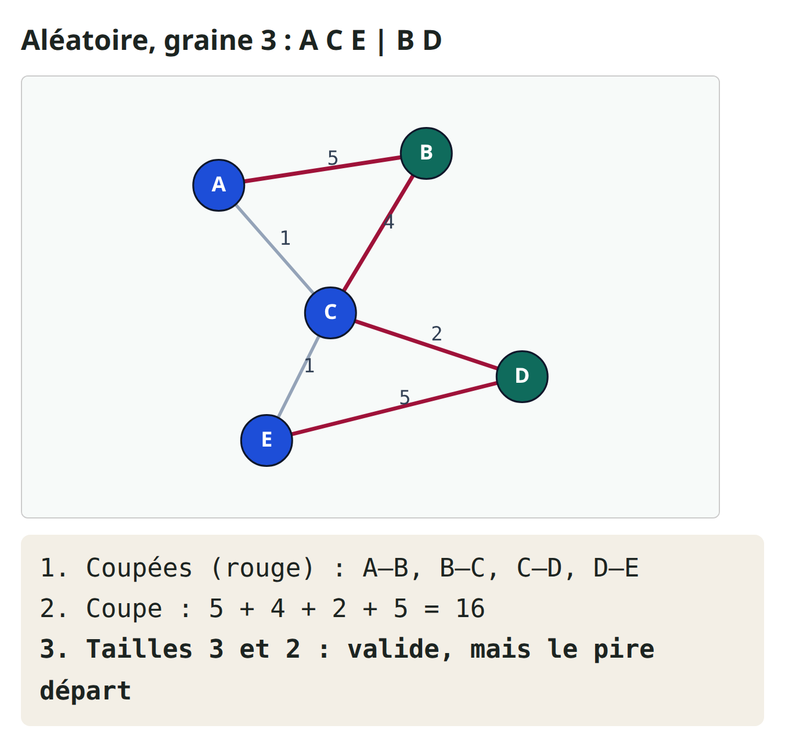

---

## La croissance dépend du nœud de départ
- La croissance n'a pas de hasard, mais elle a un choix : le nœud de départ
- Partons de A au lieu de D
- L'arête la plus lourde qui sort de A va vers B, avec un poids de cinq, donc B rejoint A
- Avec deux cellules, le côté est plein, et il s'arrête
- C, D et E forment l'autre côté, donc A–C et B–C sont coupées
- Un plus quatre font cinq, ce qui est pire que trois
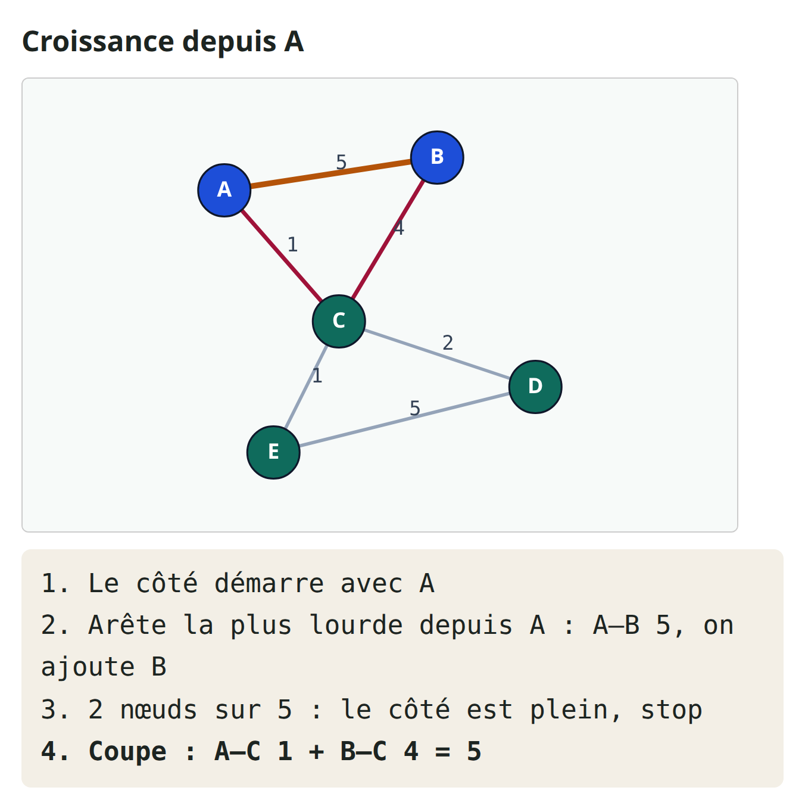

---

## Garder le meilleur départ valide
- La solution est simple : ne jamais faire confiance à un seul départ
- Construisez-en plusieurs : graines aléatoires, glouton, croissance depuis chaque nœud
- Jetez toute partition qui enfreint la règle de taille
- Gardez celle dont la coupe est la plus petite
- Ici, le glouton et les cinq croissances donnent trois, cinq, cinq, neuf, trois, trois
- Le meilleur est trois : A, B et C contre D et E

---

## Garder le meilleur départ valide — try these

```
best_start(graph):
  starts = random(seed) pour quelques graines
         + greedy
         + grow(x) pour chaque nœud x
  jeter chaque départ qui n'est pas valide
  renvoyer le départ de plus petite taille de coupe
```

---

## Une limite de taille garde la partition valide
- Voici une étoile : A est au milieu, relié à toutes les autres cellules
- A–B pèse neuf, et les quatre autres arêtes pèsent cinq
- Avec six cellules, chaque côté doit en contenir exactement trois
- Un ancien glouton sans limite de taille ajoutait toujours des cellules près de A
- Il finissait avec cinq cellules contre une : coupe cinq, mais pas valide
- Notre glouton arrête chaque côté à trois cellules, et obtient quinze
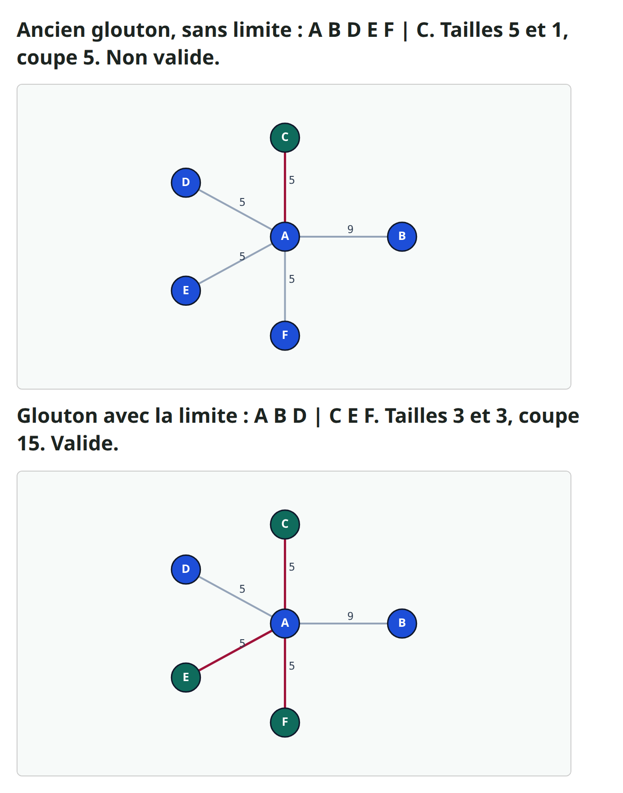

---

## Une égalité peut décider du résultat
- Dans ce graphe, A–B et D–E pèsent de nouveau cinq toutes les deux
- Le glouton doit en choisir une pour démarrer
- La règle prend le plus petit nom, A–B, et cela donne une taille de coupe de neuf
- Démarrer de D–E donne une taille de coupe de quatre
- Une simple règle de départage a donc plus que doublé la coupe
- La croissance depuis C trouve aussi quatre, une raison de plus d'essayer plusieurs départs
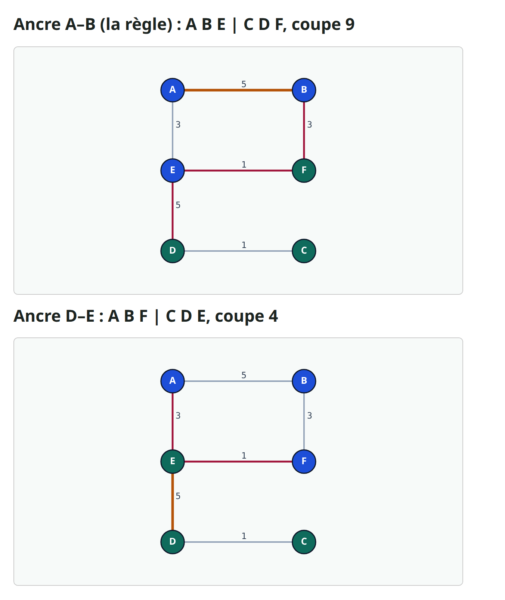

---

## Le fil le plus lourd n'est pas toujours à l'intérieur
- Voici deux triangles, reliés par un seul pont, C–D, de poids quatre
- Chaque arête de triangle pèse trois
- La coupe naturelle met un triangle de chaque côté, et ne coupe que le pont
- Mais le glouton démarre de l'arête la plus lourde, et ici c'est le pont lui-même
- C et D commencent donc du même côté, et la coupe finit à douze
- La croissance depuis A garde son triangle ensemble et ne coupe que le pont : quatre
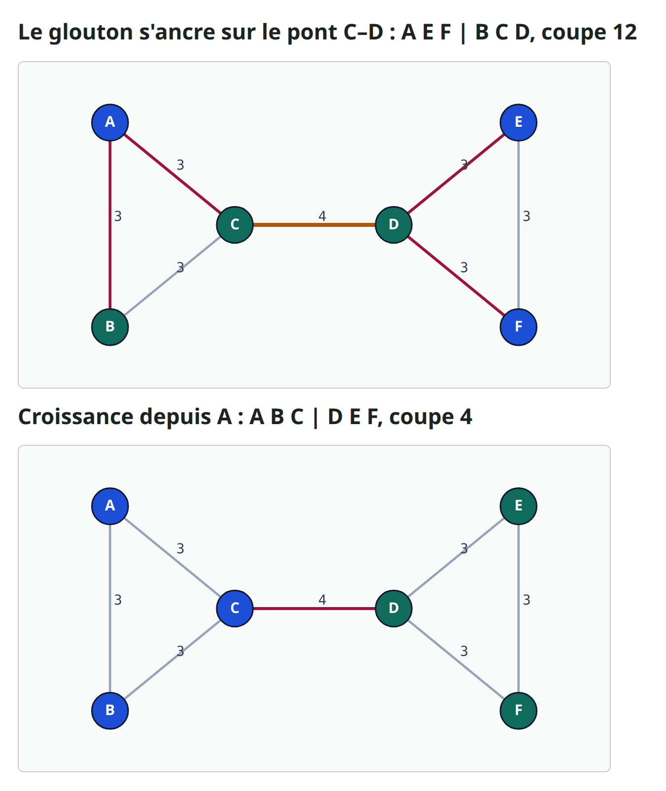

---

## Parcours lab dans le navigateur
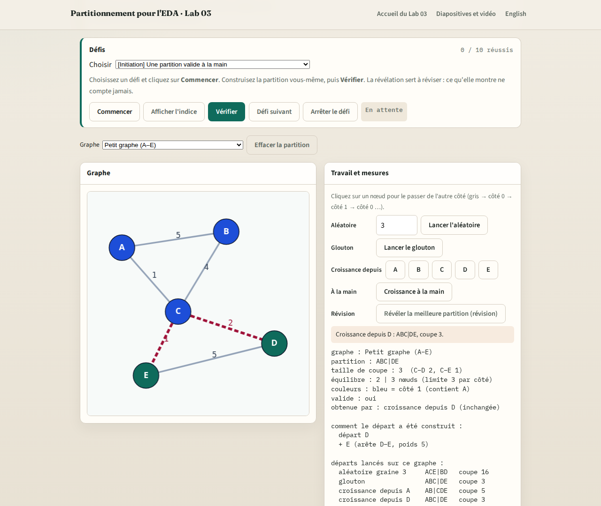

---

## Parcours implémentation
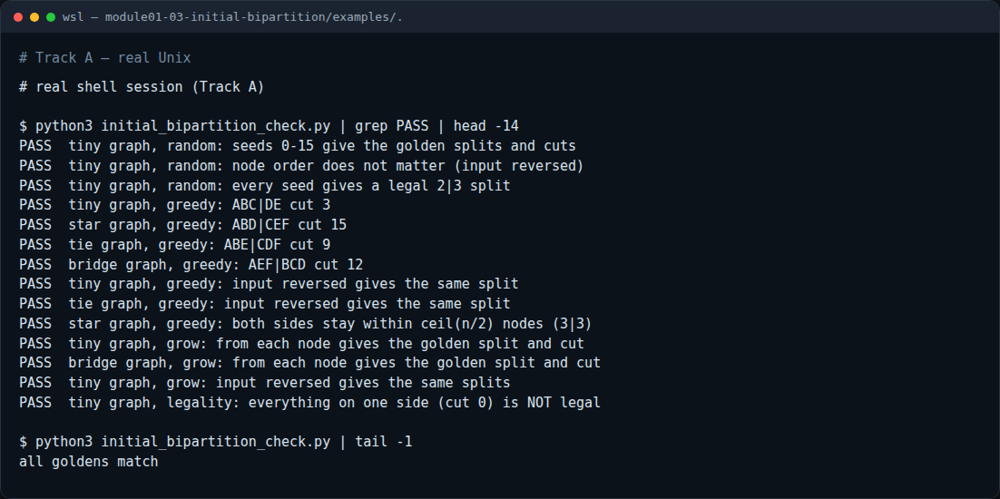

---

## Parcours implémentation — try these

```
# afficher toutes les bonnes réponses
python3 examples/initial_bipartition_check.py --show

# vérifier vos propres fonctions
python3 examples/initial_bipartition_check.py --impl my_init.py
```

---

## Pièges à éviter
- Attention à quatre erreurs courantes
- Donner la taille de coupe sans l'équilibre
- Laisser un côté dépasser sa limite, ce qui embellit la coupe
- Se fier à une seule graine : ici, la coupe va de trois à seize
- Et départager selon l'ordre de l'entrée : la réponse change avec le fichier

---

## Bilan : trois façons de démarrer
- Des méthodes comme KL et FM ont besoin d'une première partition valide
- L'aléatoire mélange et distribue : c'est rapide, mais cela dépend de la chance
- Le glouton garde l'arête la plus lourde dedans, puis coupe le moins possible
- La croissance s'étend depuis un nœud de départ, donc le nœud de départ compte
- Les égalités et les limites de taille peuvent changer la réponse
- Construisez plusieurs départs, gardez les valides, choisissez la plus petite coupe

---

## À vous de jouer
- C'est maintenant à vous
- Choisissez un parcours : le lab dans le navigateur, le parcours Python, ou les deux
- Cochez chaque case de la liste de contrôle au fur et à mesure
- Puis faites le court quiz pour vérifier les idées principales
- La suite, c'est Kernighan–Lin, qui part de votre partition et l'améliore

